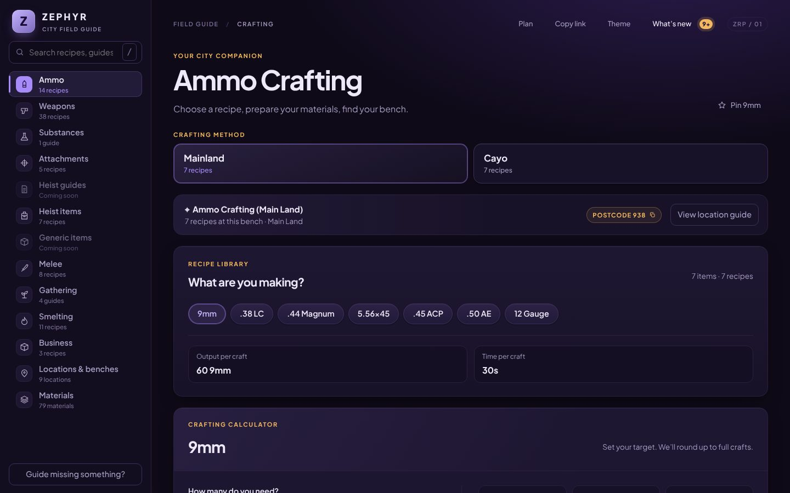
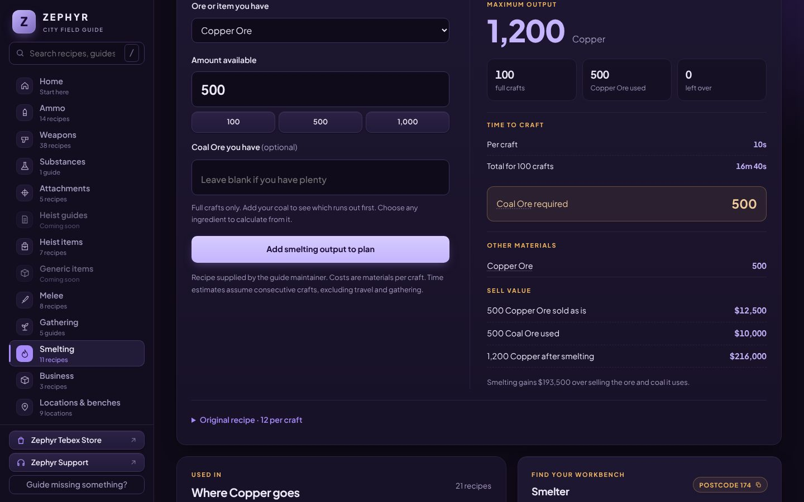
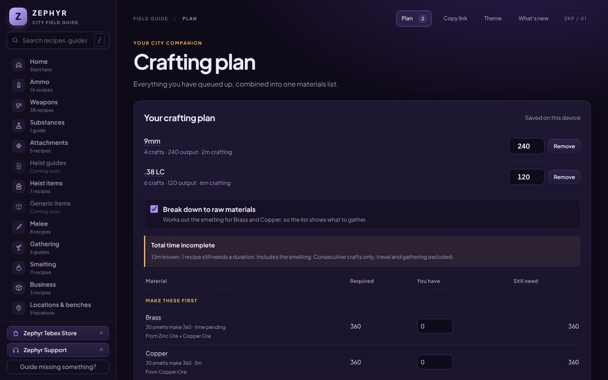
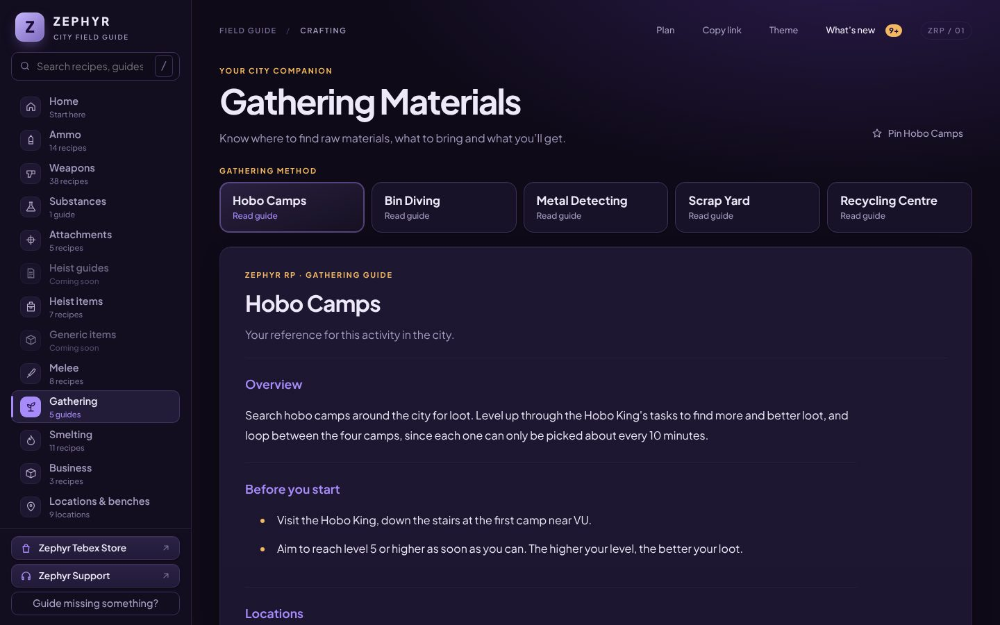
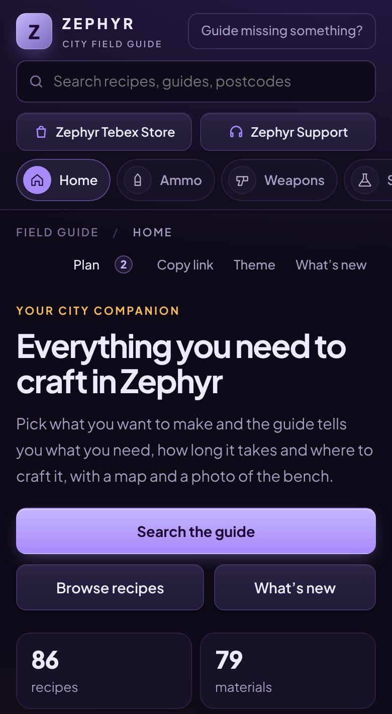

# Zephyr City Field Guide

**Your pocket companion for life in Zephyr RP.**

Recipes, materials, maps and benches, all in one place, so you can spend less time asking around and more time playing.

### [Open the guide →](https://uxmbra.github.io/zephyr-guide/)

 

 

## What is it?

The Field Guide is a free, community-made handbook for the city. Pick what you want to make, and it tells you exactly what you need, how long it takes, and where to go to craft it, with a map and a photo of the bench so you know you're in the right spot.

Everything in the guide has been gathered from real play in the city. Nothing is guessed. Where a detail isn't confirmed yet, the guide says so.

## What's inside

| | Section | What you'll find |
|:-:|---|---|
| 🎯 | **Ammo** | Every calibre from 9mm to 12 Gauge, with recipes for both the Mainland and Cayo |
| 🔫 | **Weapons** | Pistols, SMGs, shotguns and rifles, sorted by bench tier |
| 🧪 | **Substances** | Step-by-step guides with field and lab locations |
| 🔧 | **Attachments** | Suppressors and extended clips for pistols, SMGs and rifles |
| 🧰 | **Heist items** | Bolt cutters, thermite, electronic kits, C4, bombs and the big drill |
| 🗡️ | **Melee** | From a humble baseball bat to a katana (and a pink electric guitar) |
| 🌿 | **Gathering** | Guides to Hobo Camps, Bin Diving, Metal Detecting, the Scrap Yard and the Recycling Centre |
| 🔥 | **Smelting** | Turn raw ore into brass, steel, copper, gold and more, and see what it all sells for |
| 🔩 | **Business** | Repair kits and performance parts for mechanics |
| 📍 | **Locations & benches** | Postcodes, map screenshots and bench photos for every spot |

Heist guides and generic items are on the way.

## Take a look

<table>
<tr>
<td width="50%"> <b>Smelting calculator.</b> Enter the ore you've got to see what it makes, how long it takes and what it's worth.</td>
<td width="50%"> <b>Crafting plan.</b> Queue up several recipes and get one shopping list, down to the raw ore.</td>
</tr>
<tr>
<td width="50%"> <b>Gathering guides.</b> Where to go, what to bring and what you'll come back with.</td>
<td width="50%" align="center"> <b>On your phone.</b> Keep it open beside the game, even with no connection.</td>
</tr>
</table>

## Handy features

- **Crafting calculator.** Say how many you need and the guide works out how many crafts it takes and every material to gather.
- **"What can I make?"** Tell the smelter how much ore you've got and see what it turns into, plus what the ore, coal and finished metal sell for.
- **Crafting plan.** Add several recipes to one list and get a single combined shopping list, minus anything you already have. The plan has its own page, amounts can be changed in the list, and it is saved on your device.
- **Down to the ore.** Tick "Break down to raw materials" and the plan works out the smelting for you, so the list shows what to actually go and gather.
- **Share a plan.** Copy plan link gives your crew a link that opens the same recipes and amounts.
- **Pins.** Keep the recipes, guides and materials you use most at the top of the menu.
- **Materials.** Look up any material to see how to get it and every recipe that uses it. Material names in the calculator and plan link straight there.
- **Search.** Type a recipe, material, guide, bench or postcode and jump straight to it. Several words work too, such as "cayo 9mm". Press `/` to start typing.
- **Shareable links.** Every recipe, tier, guide, material and location has its own address. Copy link grabs it, so you can send a mate straight to the Cayo 9mm recipe or the smelter.
- **Copy a postcode.** Tap any postcode tag to copy the number for your GPS.
- **What's new.** A changelog of every update to the guide, with a badge for the changes you haven't read yet.
- **Themes.** Pick a look from the Theme button: Zephyr purple, Slate, Light, Midnight, Nord, Dracula, Solarized or High contrast, or match your device. Saved on your device.
- **Time estimates.** See roughly how long a batch will take before you commit to it.
- **Maps and photos.** Tap any picture to enlarge it.
- **Works on your phone.** Keep it open on a second screen or your phone while you play, or add it to your home screen.
- **Zephyr links.** The Zephyr Tebex Store and Zephyr Support are one tap away from the menu.
- **Works offline.** After your first visit the guide is saved on your device, so it still opens with no connection.

## How to open it

Just visit **[uxmbra.github.io/zephyr-guide](https://uxmbra.github.io/zephyr-guide/)** in any browser. There's nothing to install and no account needed. Bookmark it and you're set.

## Spotted something wrong?

Recipes change and new things get added to the city all the time. If a recipe looks off, a bench has moved, or you know something the guide doesn't, let us know and we'll get it updated.

- **Discord:** send a DM to **uxmbra** with what you saw and where.
- **[Report a problem →](https://github.com/uxmbra/zephyr-guide/issues/new?template=report-a-problem.yml)** (takes about a minute; screenshots welcome)

You'll find both under **Guide missing something?** in the guide too.

 

Made by the community, for the city.
 
Looking after the guide? See <a href="MAINTAINING.md">MAINTAINING.md</a>.

