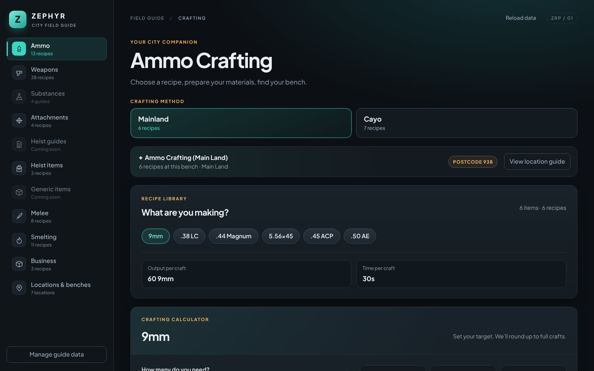

# Zephyr City Field Guide

**Your pocket companion for life in Zephyr RP.**

Recipes, materials, maps and benches, all in one place, so you can spend less time asking around and more time playing.

### [Open the guide →](https://uxmbra.github.io/zephyr-guide/)

 

 

## What is it?

The Field Guide is a free, community-made handbook for the city. Pick what you want to make, and it tells you exactly what you need, how long it takes, and where to go to craft it, with a map and a photo of the bench so you know you're in the right spot.

Everything in the guide has been gathered from real play in the city. Nothing is guessed. Where a detail isn't confirmed yet, the guide says so.

## What's inside

| | Section | What you'll find |
|:-:|---|---|
| 🎯 | **Ammo** | Every calibre from 9mm to 12 Gauge, with recipes for both the Mainland and Cayo |
| 🔫 | **Weapons** | Pistols, SMGs, shotguns and rifles, sorted by bench tier |
| 🧪 | **Substances** | Step-by-step guides with field and lab locations |
| 🔧 | **Attachments** | Suppressors, extended clips and more |
| 🧰 | **Heist items** | Bolt cutters, thermite and electronic kits |
| 🗡️ | **Melee** | From a humble baseball bat to a katana (and a pink electric guitar) |
| 🔥 | **Smelting** | Turn raw ore into brass, steel, copper, gold and more |
| 🔩 | **Business** | Repair kits and performance parts for mechanics |
| 📍 | **Locations & benches** | Postcodes, map screenshots and bench photos for every spot |

Heist guides and generic items are on the way.

## Handy features

- **Crafting calculator.** Say how many you need and the guide works out how many crafts it takes and every material to gather.
- **"What can I make?"** Tell the smelter how much ore you've got and see what it turns into.
- **Crafting plan.** Add several recipes to one list and get a single combined shopping list, minus anything you already have.
- **Time estimates.** See roughly how long a batch will take before you commit to it.
- **Maps and photos.** Tap any picture to enlarge it.
- **Works on your phone.** Keep it open on a second screen or your phone while you play.

## How to open it

Just visit **[uxmbra.github.io/zephyr-guide](https://uxmbra.github.io/zephyr-guide/)** in any browser. There's nothing to install and no account needed. Bookmark it and you're set.

## Spotted something wrong?

Recipes change and new things get added to the city all the time. If a recipe looks off, a bench has moved, or you know something the guide doesn't, let us know and we'll get it updated.

 

Made by the community, for the city.
 
Looking after the guide? See <a href="MAINTAINING.md">MAINTAINING.md</a>.

